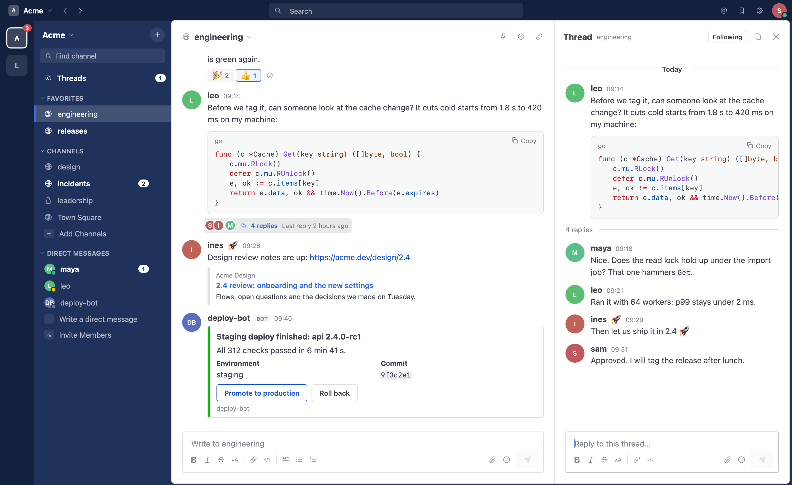
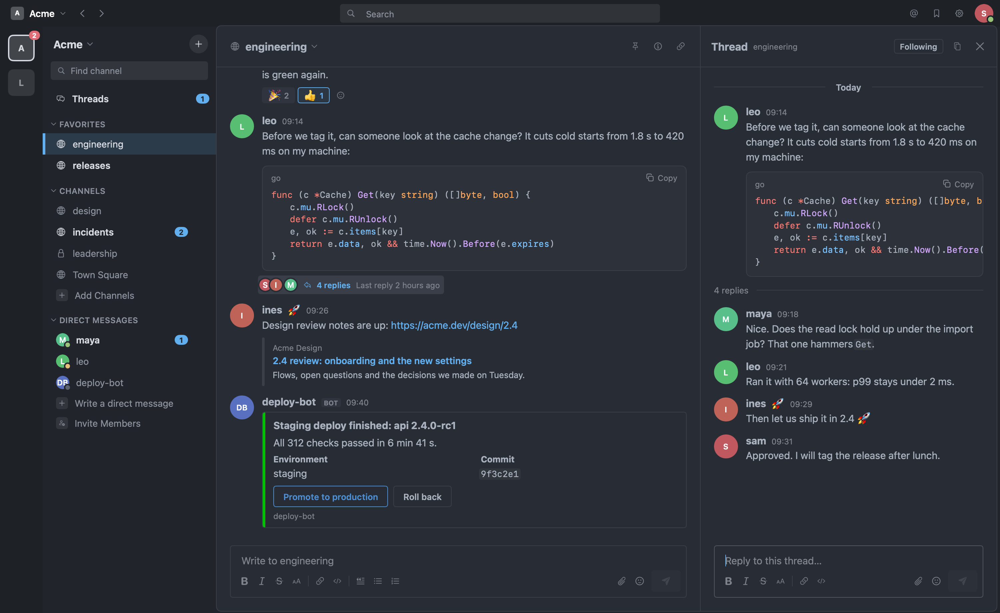

<div align="center">


# Mattermost Go

**A native Mattermost client for macOS. No Electron, no browser engine.**

[](https://github.com/txchen/mattermostgo/releases/latest)


[](LICENSE)

</div>



Mattermost Go talks to your Mattermost server through its API and draws
the whole interface natively in Go. It works like the official app (the
same sidebar, threads, search and integrations) at a fraction of its
size and memory, and next to no CPU while it waits in the background.

## Smaller and lighter

Measured on an Apple M1 against the official Mattermost Desktop 6.3.2:

| | Mattermost Go | Official desktop app |
|---|---:|---:|
| Download | **9 MB** | 232 MB |
| App on disk | **30 MB** | 296 MB |
| Processes | **1** | 11 |
| Memory | **98 MB**, logged in with a channel open | 338 MB, before adding a server |
| CPU in the background, per minute | **under 0.01 s** | 1.0 s |

Both download sizes are of the universal apps. The official app was
measured on its first screen, before it loads the webapp, so its real use
is higher. [How these were measured](docs/benchmarks.md), and how to
check them on your own server.

## Install

With [Homebrew](https://brew.sh):

```sh
brew install --cask txchen/tap/mattermost-go
```

Or download the dmg from the [latest release](https://github.com/txchen/mattermostgo/releases/latest).
The app is signed and notarized, runs on macOS 12 or later, and is one
universal app for Apple Silicon and Intel Macs. It installs next to the
official app and does not touch its settings.

Update with `brew upgrade --cask mattermost-go`.

## What it does

**Chat**
- Channels, direct and group messages, and Collapsed Reply Threads, with the
  Threads view of the threads you follow.
- Markdown with code highlighting, tables, emoji, mentions and channel links;
  link previews and message attachments.
- Reactions, edits, pinned and saved messages, reminders, forwarding, and
  edit history.
- An emoji picker with skin tones and your server's custom emoji.
- Files by drag, paste or picker, and a preview for images, text and code,
  with Quick Look for the rest.
- Real-time posts, reactions, typing and read state across your devices.

**Find things**
- Search messages and files, Recent mentions, Saved messages.
- Jump to any post from a result or a link.
- Find channels and people with ⌘K, and go back and forward with ⌘[ and ⌘].

**Organize**
- Sidebar categories you can drag, sort, mute and collapse; favorites;
  unread channels grouped first if you like.
- Create, browse, rename, archive and unarchive channels; edit headers and
  purposes; manage members and channel admins; convert between public and
  private.
- Open any channel or thread in a window of its own.

**Integrations**
- Incoming and outgoing webhooks, slash commands and bot accounts with
  tokens, created and edited in the app.
- Buttons, menus and dialogs from bots and integrations.
- Slash commands complete as you type.

**You**
- Status, Do Not Disturb with an end time, and custom status.
- Your profile, picture, password, multi-factor authentication, sessions
  and personal access tokens.
- Desktop notifications with your server's rules, per-channel preferences,
  and the Dock badge.
- Light and dark themes, including soft dark ones (One Dark, Nord, Dusk)
  that follow the system if you want; 12 or 24 hour clock; compact
  messages.
- Several servers at once, each with its own login.



## Not there yet

- Single sign-on (GitLab, Google, Office 365, SAML, OpenID). Logging in
  takes a username or email and a password, with MFA.
- Plugins with their own interface, such as Calls, Boards and Playbooks.
- Servers with self-signed certificates, client certificates, and proxies
  that ask for a password.
- Uploading custom emoji, and push and email notification settings.
- Linux and Windows. The code builds there, but nobody has tested it.

## Privacy

The app talks only to the servers you add. Session tokens stay in the
macOS Keychain. Link previews come from your server, which fetches them;
their images load straight from the sites they are on. There is no
telemetry.

## Contributing

[CONTRIBUTING.md](CONTRIBUTING.md) covers building from source, the test
server, and the end-to-end and real-window checks. The
[design](docs/design.md) and the [decisions](docs/adr/) explain how the
app is put together.

## License

Apache 2.0. Mattermost is a trademark of Mattermost, Inc. This project is
not affiliated with or endorsed by Mattermost, Inc.
